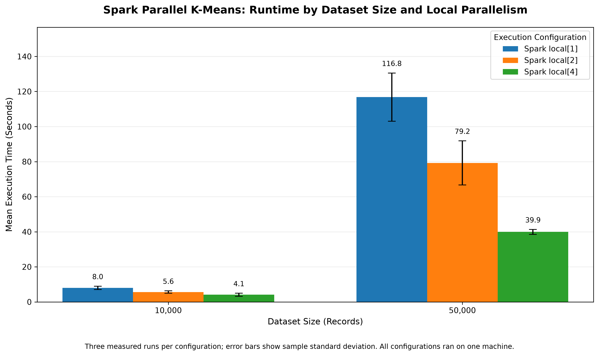
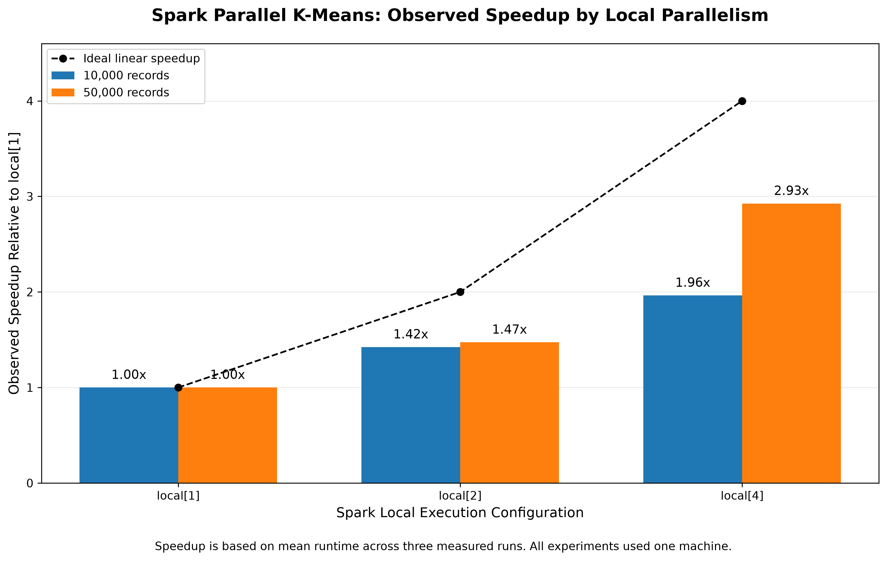
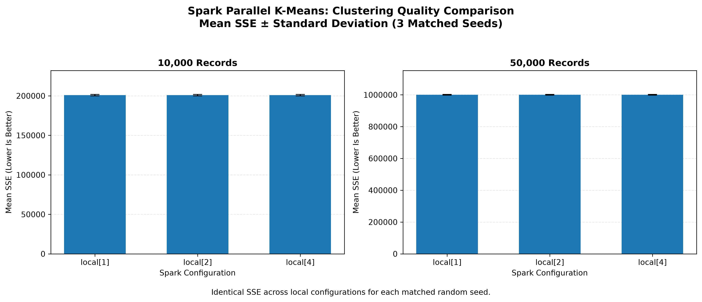
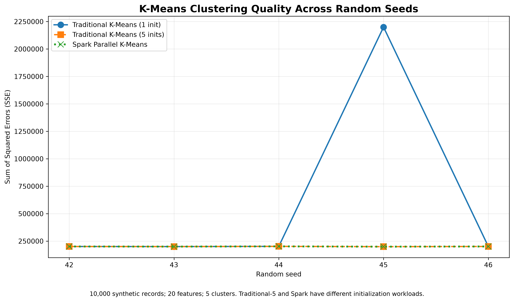

# Parallel K-Means Clustering Using Apache Spark: Implementation and Performance Evaluation

## Abstract

K-Means is a widely used clustering algorithm for organizing unlabeled data into groups based on similarity. However, its computational requirements can increase substantially as datasets become larger. This project investigates a parallel implementation of K-Means using Apache Spark, inspired by the research paper *Big Data Clustering Method Based on Parallel K-Means* by Liu et al. (2024).

The implementation uses a partition-based approach in which K-Means is first performed independently on individual Spark partitions. The resulting local cluster centers are aggregated to initialize a global clustering model, followed by distributed iterations that update cluster assignments and centers. A traditional single-process K-Means implementation is also evaluated to examine differences in runtime, initialization behavior, and clustering quality.

Experiments were conducted using synthetic datasets containing 10,000 and 50,000 observations, each with 20 numerical features and five underlying clusters. Apache Spark was evaluated using `local[1]`, `local[2]`, and `local[4]` configurations on a single Apple Silicon computer. Performance was measured using execution time, parallel speedup, sum of squared errors (SSE), and convergence behavior.

For the 50,000-record dataset, mean execution time decreased from 116.765 seconds with `local[1]` to 39.918 seconds with `local[4]`, representing approximately 2.925× speedup. The corresponding clustering SSE remained consistent across the tested Spark configurations. These findings indicate that increasing local parallelism can improve execution time while maintaining clustering quality for the evaluated datasets.

The results demonstrate the potential benefits of parallel K-Means while highlighting limitations associated with single-machine execution, synthetic datasets, initialization strategies, and memory requirements. Further evaluation using larger real-world datasets and multiple physical computing nodes would be necessary to establish performance in a distributed production environment.

---

## Introduction

The increasing availability of large datasets has created a need for data analysis methods that can process information efficiently. Clustering is an unsupervised learning technique used to identify groups of similar observations without requiring predefined class labels. One commonly used clustering method is K-Means, which assigns observations to clusters and repeatedly updates their centers to reduce within-cluster variation.

Although traditional K-Means is relatively straightforward to implement, its computational requirements can become significant as the number of observations and features increases. Each iteration requires assigning observations to their nearest cluster centers and updating those centers. For sufficiently large datasets, these repeated calculations can increase execution time and create challenges for systems with limited computing resources.

Parallel processing offers a potential approach to addressing these challenges. By distributing calculations across multiple processing units, a clustering algorithm may reduce execution time while preserving the quality of its results. Apache Spark provides a framework for parallel data processing through distributed data structures and operations, including Resilient Distributed Datasets (RDDs), partition transformations, broadcast variables, and keyed reductions.

This project investigates a Spark-based Parallel K-Means implementation inspired by the research paper *Big Data Clustering Method Based on Parallel K-Means* by Liu et al. [1]. The original study presents a parallel clustering approach designed for large datasets. Our project adapts its partition-based clustering and global refinement concepts into a custom Python and PySpark implementation.

The implemented algorithm first performs K-Means independently within Spark partitions. The resulting local cluster centers are collected and aggregated to initialize a global clustering model. Distributed iterations then assign observations to their nearest centers, combine cluster statistics, and update the global centers until a stopping criterion is satisfied.

To evaluate this approach, we conduct experiments using synthetic datasets containing 10,000 and 50,000 observations, each with 20 numerical features and five underlying clusters. We compare Spark execution configurations using one, two, and four local worker threads. We also implement a conventional single-process K-Means baseline to examine differences in runtime, initialization behavior, and clustering quality.

The evaluation focuses on execution time, parallel speedup, sum of squared errors (SSE), and convergence behavior. Particular attention is given to whether increasing local parallelism reduces execution time without substantially changing clustering quality.

Unlike the original research paper's multi-node experimental environment, our experiments run on a single Apple Silicon computer using Spark local mode. Consequently, the reported findings characterize single-machine parallel execution rather than performance across multiple physical computing nodes.

The primary contribution of this project is a reproducible implementation and experimental evaluation of a partition-based Parallel K-Means approach. The project also documents important differences between the research paper and our implementation, including initialization choices, experimental scale, timing boundaries, and hardware limitations.

---

## Related Work

### Traditional K-Means Clustering

K-Means is a widely used unsupervised learning algorithm that partitions a dataset into a specified number of clusters. The algorithm repeatedly assigns each observation to its nearest cluster center and recalculates the centers using the observations assigned to each cluster. This iterative procedure seeks to reduce the sum of squared distances between observations and their assigned centers.

The classical K-Means approach is closely associated with the work of Lloyd [2]. Its simplicity makes it useful for many clustering applications. However, the repeated assignment and center-update operations can become computationally expensive as dataset size increases.

Traditional K-Means is also sensitive to initialization. Different starting centers can produce different final clustering solutions because the algorithm may converge to a local minimum rather than the globally optimal clustering.

### K-Means++ Initialization

Arthur and Vassilvitskii introduced K-Means++ as an improved initialization method for K-Means [3]. Instead of choosing every initial center uniformly at random, K-Means++ selects subsequent centers using probabilities related to the squared distance from the nearest previously selected center.

This approach encourages the selection of initially well-separated centers and can improve clustering quality compared with less carefully chosen starting points.

Initialization is particularly relevant to our project because the traditional baseline and parallel implementation use different procedures for selecting their initial global centers. Consequently, clustering quality and runtime comparisons must account for these differences.

### Scalable K-Means++ and Large-Scale Clustering

Bahmani et al. proposed Scalable K-Means++, commonly associated with the K-Means|| initialization approach, to address limitations of sequential K-Means++ initialization on large datasets [4].

The method uses an oversampling strategy that can reduce the number of sequential passes required during initialization. This research demonstrates that initialization itself is an important consideration when designing clustering methods for large-scale data processing.

Our implementation does not reproduce K-Means||. Instead, it uses partition-level clustering to generate candidate centers and aggregates those candidates to initialize the global model. Scalable K-Means++ is included as related research rather than as a component we implemented.

### Parallel K-Means Using Apache Spark

Liu et al. presented a parallel K-Means approach designed for large datasets [1]. Their method uses partition-based processing, local clustering, center aggregation, and global refinement to support clustering in a parallel computing environment.

The paper provides the primary research foundation for our project. We adapt its general workflow into a custom Python and PySpark implementation, using Spark partitions for local clustering and distributed operations for global center updates.

Apache Spark supports operations such as partition transformations, broadcast variables, and keyed reductions. These capabilities provide mechanisms for processing partitioned data and combining intermediate clustering statistics [5].

Our implementation uses these mechanisms to perform local clustering and global refinement. However, it differs from the original study in several respects, including initialization details, experimental datasets, execution environment, and timing boundaries.

The original research includes experiments in a distributed computing environment. Our evaluation uses Spark local mode on a single Apple Silicon computer. Therefore, our results examine the effect of local parallelism rather than demonstrating scalability across multiple physical computing nodes.

### Research Gap and Project Contribution

Previous research establishes the importance of efficient clustering, careful initialization, and parallel processing for large datasets. Building on these ideas, our project investigates whether a partition-based Spark implementation can reduce execution time while maintaining comparable clustering quality under controlled experimental conditions.

The project contributes a reproducible implementation, a traditional K-Means baseline, and experimental comparisons across Spark local configurations. It also documents the limitations of interpreting performance results when algorithms use different initialization procedures or operate under different hardware conditions.

---

## Original Research Paper and Implementation Comparison

### Research Foundation

Our project is inspired by *Big Data Clustering Method Based on Parallel K-Means* by Liu et al. [1]. The paper investigates how parallel processing can improve the efficiency of K-Means clustering for large datasets.

The proposed approach combines partition-level clustering with global refinement. Rather than relying exclusively on a traditional single-process clustering procedure, the algorithm distributes selected operations across a parallel processing environment.

Our implementation follows the general research direction of the paper while adapting several algorithmic and experimental details to our available hardware and software environment.

### Comparison of the Original Method and Our Implementation

| Component | Original Research Paper [1] | Our Implementation |
|---|---|---|
| Main objective | Improve large-scale clustering through parallel K-Means | Evaluate a partition-based Spark K-Means implementation |
| Processing framework | Apache Spark | Python and PySpark RDD operations |
| Data partitioning | Data distributed across partitions | Spark RDD partitioning |
| Local clustering | K-Means performed on partitioned data | Custom K-Means executed within partitions |
| Local initialization | Partition-level initialization procedure | K-Means++ initialization within local clustering |
| Candidate centers | Local clustering results combined for global initialization | Local candidate centers aggregated using deterministic restarts |
| Global assignment | Parallel cluster assignment | Distributed nearest-center assignment |
| Global aggregation | Parallel combination of clustering statistics | Spark keyed reductions using `reduceByKey` |
| Center distribution | Cluster centers made available to parallel workers | Spark broadcast variables |
| Convergence | Global stopping criterion | Absolute change in successive SSE values |
| Datasets | KDD Cup99 and large synthetic data | Synthetic datasets with 10,000 and 50,000 records |
| Features | Dataset-dependent | 20 numerical features |
| Number of clusters | Dataset-dependent | Five clusters |
| Computing environment | Distributed computing environment | Single Apple Silicon computer using Spark local mode |
| Evaluation | Execution time and clustering quality | Runtime, speedup, SSE, and convergence |
| Traditional baseline | Traditional K-Means | Custom single-process K-Means with initialization variants |

### Implementation Similarities

Both approaches use partition-based processing to perform local clustering before global refinement. This design allows local computations to contribute candidate cluster centers for the subsequent global clustering process.

Our implementation also follows the broader idea of distributing assignment and aggregation operations rather than processing every iteration entirely within a conventional single-process algorithm.

These similarities establish the connection between the research paper and our implementation.

### Implementation Differences

Our implementation is not a line-by-line reproduction of the original algorithm. We use custom Python clustering functions, K-Means++ local initialization, deterministic candidate-center aggregation restarts, and an SSE-based stopping criterion.

The experimental environments also differ substantially. The original paper investigates parallel clustering using larger datasets and distributed computing resources. Our experiments evaluate Spark local configurations on one computer.

Additionally, our synthetic datasets are smaller than those used in the original paper. We therefore do not claim to reproduce its large-scale experimental results.

### Interpretation of Experimental Comparisons

Because the two studies use different datasets, computing environments, implementation details, and timing boundaries, their raw execution times and SSE values should not be treated as directly comparable measurements.

Our analysis instead focuses on comparisons within our own controlled experimental environment.

In particular, we evaluate how increasing local Spark parallelism affects execution time and whether clustering quality remains consistent across configurations.

We also compare our parallel implementation with a traditional K-Means baseline. However, differences in initialization procedures and computational workloads mean that these comparisons require careful interpretation.

### Reproduction Scope

The project should be understood as a research-inspired implementation and experimental evaluation of Parallel K-Means using Apache Spark.

It demonstrates several important concepts from the original paper, including local clustering, center aggregation, distributed global updates, and iterative convergence.

It does not establish that the original paper's complete experimental results have been independently reproduced.

---

## 1. Research Objective and Experimental Design

This project investigates the performance and clustering behavior of a Spark-based Parallel K-Means implementation inspired by the research paper *Big Data Clustering Method Based on Parallel K-Means* by Liu et al. [1].

The primary objective is to evaluate whether parallelizing K-Means operations improves execution time as dataset size increases while maintaining comparable clustering quality.

To investigate this question, we implemented a Parallel K-Means pipeline using Apache Spark. The implementation performs local clustering within individual Spark partitions, combines the resulting candidate centers to initialize the global model, and then performs distributed global clustering.

We also implemented a conventional, single-process K-Means baseline to examine differences in initialization behavior, clustering quality, and runtime. Because the baseline and parallel implementations use different initialization procedures, we interpret their runtime results cautiously rather than treating them as directly equivalent workloads.

Our experimental evaluation focuses on three main areas:

1. **Execution time:** Measuring the time required to complete the clustering pipeline under different Spark local execution configurations.
2. **Parallel scalability:** Evaluating how runtime changes when Spark is configured with one, two, or four local worker threads.
3. **Clustering quality:** Comparing the sum of squared errors (SSE) produced by the algorithms and verifying whether parallel execution preserves clustering quality.

The principal scalability experiments use synthetic datasets containing 10,000 and 50,000 records. Each dataset has 20 numerical features and five underlying clusters.

All scalability experiments are performed on a single Apple Silicon computer using Apache Spark in local mode. Therefore, the results measure single-machine parallel execution rather than performance across multiple physical cluster nodes.

For reproducibility, the experiments use controlled random seeds, fixed clustering parameters, repeated measurements, and an initial unmeasured warm-up run for each Spark-master process before its benchmark matrix.

The evaluation also considers limitations associated with initialization strategies, memory requirements, the number of experimental repetitions, and the use of synthetic data.

## 2. Parallel K-Means Algorithm and Implementation

### 2.1 Overview

Our implementation follows a partition-based initialization and distributed refinement strategy inspired by Liu et al. [1]. Instead of calling Spark MLlib's K-Means estimator, the project implements the clustering operations explicitly in Python and PySpark. The process has three principal stages: local clustering within Spark partitions, aggregation of candidate centers, and global refinement across the distributed dataset.

### 2.2 Nine-Step Algorithm

1. **Prepare the input.** Generate a numerical dataset with a specified number of observations, features, clusters, and random seed. Construct a Spark RDD with a fixed partition count.
2. **Partition the observations.** Distribute the RDD across four Spark partitions for the reported scalability experiments.
3. **Cluster within each partition.** Use `mapPartitionsWithIndex` to run local K-Means independently on each nonempty partition. Each local run uses seeded K-Means++ initialization and squared Euclidean distance.
4. **Collect candidate centers.** Return the local centers from the partition workers to the driver. With four nonempty partitions and five local clusters each, the expected candidate pool contains 20 centers.
5. **Aggregate candidate centers.** Run local K-Means on the collected centers using five deterministic initialization restarts. Select the candidate-center solution with the lowest aggregation SSE to initialize the global model. These candidate centers are **not weighted by their originating partition's population**.
6. **Broadcast global centers.** Distribute the current global centers to Spark workers using a broadcast variable for each global refinement iteration.
7. **Assign points and aggregate statistics.** Assign each observation to its nearest center, then use `reduceByKey` to combine coordinate sums, point counts, and SSE contributions by cluster.
8. **Update and check convergence.** Compute updated global centers from the aggregated sums and counts. Repeat distributed assignment and updating until the absolute change in consecutive-iteration SSE is at most `1e-6`, or 100 global iterations have been reached.
9. **Evaluate final centers.** Run a final distributed evaluation using the returned centers to calculate final SSE and cluster counts. Record convergence information, iteration counts, and phase runtimes.

This is a nine-step description of **our implementation**, not a claim that every implementation detail exactly reproduces the paper.

### 2.3 Objective Function and Center Updates

K-Means minimizes the within-cluster sum of squared Euclidean distances:

$$
\mathrm{SSE} = \sum_{i=1}^{n} \left\|x_i - \mu_{c(i)}\right\|_2^2,
$$

where `x_i` is observation `i`, `c(i)` is its assigned cluster, and `μ` denotes a cluster center. For a nonempty cluster `j`, its updated center is the arithmetic mean of assigned observations:

$$
\mu_j = \frac{1}{|C_j|}\sum_{x_i \in C_j} x_i.
$$

The distributed implementation calculates these means from aggregated coordinate sums and counts rather than collecting all assigned observations at the driver.

### 2.4 Local and Global Stopping Criteria

Local K-Means uses a maximum **squared center shift** threshold of `1e-6`. Global K-Means uses an **absolute change in consecutive-iteration SSE** threshold of `1e-6`. Both stages allow at most 100 iterations. Although the tolerances share a numerical value, they are applied to different quantities and should not be interpreted as identical convergence tests.

During global refinement, the SSE recorded for each iteration is calculated using the cluster centers before that iteration's center update. After the stopping criterion is satisfied or the iteration limit is reached, a separate distributed evaluation calculates the final SSE and cluster counts using the final updated centers. This ensures that the reported clustering quality corresponds to the returned model.

### 2.5 Implementation Mapping

| Stage | Primary source file |
| --- | --- |
| Local K-Means, distance calculations, initialization | `src/parallel/local_kmeans.py` |
| Partition-level execution | `src/parallel/partition_clustering.py` |
| Candidate-center aggregation | `src/parallel/center_aggregation.py` |
| Distributed assignment and reduction | `src/parallel/global_iteration.py` |
| Global iteration loop and evaluation | `src/parallel/global_kmeans.py` |
| End-to-end algorithm orchestration | `src/parallel/parallel_kmeans.py` |
| Dataset generation and benchmark configuration | `src/experiments/synthetic_data.py`, `src/experiments/experiment_runner.py` |
| RDD persistence and benchmark lifecycle | `src/experiments/benchmark_runner.py` |

### 2.6 Implementation Constraints

The partition-level routine materializes each nonempty partition in its worker process before local clustering. This simplifies local K-Means but creates a memory constraint for large partitions. The aggregation stage also collects candidate centers to the driver, and the candidate centers are treated equally rather than being weighted by the number of original observations they represent. These choices are documented limitations, especially when extending the approach to imbalanced or substantially larger datasets.

The Spark operations used here—partition transformations, broadcast variables, keyed reductions, and RDD persistence—are documented in the [Apache Spark RDD Programming Guide](https://spark.apache.org/docs/latest/rdd-programming-guide.html).

## 3. Experimental Setup and Dataset Description

### 3.1 Hardware and Software Environment

The experiments were conducted on a single Apple Silicon MacBook Air equipped with an Apple M2 processor and 8 GB of unified memory. The implementation uses Python, PySpark, and Apache Spark, with Java providing the runtime required by Spark.

The experimental environment uses a project-specific Python virtual environment to manage dependencies and maintain consistency across executions.

Apache Spark was configured in local execution mode using three master settings:

- `local[1]`: One local worker thread.
- `local[2]`: Two local worker threads.
- `local[4]`: Four local worker threads.

Each configuration runs on the same physical computer. Consequently, the experiments evaluate local parallel scalability rather than distributed performance across multiple machines.

The number of Spark RDD partitions was held constant at four in the principal scalability experiments. This isolates the effect of changing the local worker-thread configuration while keeping the partition count unchanged.

### 3.2 Synthetic Dataset Generation

The principal experiments use reproducible synthetic datasets generated by the project's custom Python implementation in `src/experiments/synthetic_data.py`.

The generator constructs a specified number of cluster centers and creates observations by adding Gaussian noise around those centers. Cluster membership is assigned during generation, and records are distributed as evenly as possible among the requested clusters.

The principal dataset configurations contain:

| Parameter | Experimental setting |
| --- | --- |
| Dataset sizes | 10,000 and 50,000 records |
| Numerical features | 20 |
| Ground-truth clusters | 5 |
| Gaussian noise standard deviation | 1.0 |
| Center separation parameter | 10.0 |
| Spark RDD partitions | 4 |
| Measured random seeds | 42, 43, and 44 |

The synthetic generator uses Python's seeded random-number generator, allowing the same dataset to be reconstructed from identical parameters and a matching random seed.

This benchmark dataset is distinct from the separate dataset-preparation pipeline in `src/data/datasets.py`, which uses scikit-learn's `make_blobs` function and includes feature standardization. The principal scalability measurements described here use the custom generator rather than that separate pipeline.

### 3.3 Experimental Parameters

The Parallel K-Means experiments use a controlled configuration across the tested Spark local execution settings.

| Parameter | Value |
| --- | --- |
| Number of clusters (`k`) | 5 |
| Local K-Means maximum iterations | 100 |
| Global K-Means maximum iterations | 100 |
| Local convergence tolerance | `1e-6` |
| Global SSE-change tolerance | `1e-6` |
| Candidate-center aggregation restarts | 5 |
| Measured repetitions per configuration | 3 |
| Initial unmeasured warm-up runs per Spark-master process | 1 |

The local and global convergence tolerances are applied to different quantities. The local stage checks the maximum squared movement of cluster centers, whereas the global stage checks the absolute change in SSE between consecutive iterations.

Candidate-center aggregation uses five deterministic initialization attempts and selects the candidate-center clustering result with the lowest SSE.

### 3.4 Repetitions and Reproducibility

Each principal benchmark configuration was executed three times using random seeds 42, 43, and 44.

The repeated-experiment runner begins with the configured base seed and increments it by one for each subsequent measured repetition. This provides controlled variation while making individual runs reproducible.

For each Spark-master process, an initial unmeasured warm-up run is performed before the benchmark matrix begins. The warm-up is not repeated before every individual dataset-size configuration.

The benchmark orchestration executes the local master configurations in separate processes. This helps separate their Spark execution environments and avoids treating different master settings as simultaneous workloads.

Measured results are written to CSV files containing experimental metadata, clustering outcomes, and timing measurements. These files provide the basis for comparing runtime and clustering quality across configurations.

### 3.5 Benchmark Execution and Timing Boundaries

The in-memory synthetic benchmark follows a consistent sequence:

1. Generate the synthetic dataset using the specified configuration and seed.
2. Construct a Spark RDD with the required partition count.
3. Persist the RDD.
4. Execute an RDD count action to materialize the dataset before clustering begins.
5. Run the complete Parallel K-Means clustering pipeline.
6. Collect the resulting clustering metrics and execution timings.
7. Release the persisted RDD after the benchmark.

The clustering timer excludes synthetic-data generation, initial RDD creation, and initial RDD materialization. Therefore, the reported runtime represents the measured clustering pipeline rather than the complete end-to-end cost of preparing the input dataset.

The implementation records phase-level timings for partition clustering, candidate-center aggregation, initialization, global iteration, and final evaluation. The total clustering runtime is used for the principal scalability comparison.

Apache Spark's RDD persistence mechanism allows an RDD to be reused across operations. In this implementation, the initial count action materializes the persisted dataset before the clustering measurements begin.

### 3.6 Experimental Scope and Limitations

The principal scalability evaluation uses two synthetic dataset sizes and three measured repetitions per Spark-master configuration. These measurements provide an initial assessment of local parallel performance but do not establish behavior across all dataset sizes, hardware configurations, or distributed computing environments.

Because the experiments run on one computer, the observed speedups should not be interpreted as evidence of equivalent scaling across multiple physical cluster nodes.

The synthetic datasets contain deliberately structured Gaussian clusters. Results on these datasets may differ from results on real-world data containing irregular cluster shapes, noise, missing values, or highly imbalanced cluster populations.

A separate project dataset plan includes KDD Cup 99 preprocessing and a scikit-learn-based synthetic-data pipeline. Those planned datasets should not be presented as completed clustering benchmarks unless corresponding execution results have been verified.

Finally, the custom partition-level K-Means implementation materializes each partition within a worker process, which can limit scalability when partitions become too large for the available memory. Candidate-center aggregation also treats candidate centers equally rather than weighting them by their original partition populations.

These constraints are considered when interpreting the experimental results and identifying possible improvements.

## 4. Traditional K-Means Baseline and Comparison Design

### 4.1 Purpose of the Baseline

To provide a reference for evaluating the Spark-based Parallel K-Means implementation, we implemented a conventional single-process K-Means baseline.

The baseline processes the complete synthetic dataset within one Python process without using Apache Spark, distributed partitions, or parallel center aggregation.

Its primary purpose is to evaluate clustering quality, initialization behavior, and execution time under a conventional K-Means approach.

Because the traditional and parallel implementations use different initialization procedures, their runtime results are interpreted as descriptive comparisons rather than strictly equivalent computational workloads.

### 4.2 Traditional K-Means Implementation

The traditional baseline is implemented in `scripts/run_traditional_kmeans.py`.

It uses the project's existing local K-Means implementation from `src/parallel/local_kmeans.py`, applying the algorithm directly to the complete dataset.

The baseline follows these operations:

1. Generate a deterministic synthetic dataset using the specified configuration and random seed.
2. Initialize the cluster centers using the local K-Means implementation.
3. Assign observations to their nearest cluster centers.
4. Recalculate cluster centers using the arithmetic mean of assigned observations.
5. Repeat assignment and center updates until the stopping criterion or maximum iteration count is reached.
6. Calculate the final sum of squared errors (SSE).
7. Record convergence status, iteration count, cluster membership counts, and execution time.

The baseline uses a maximum of 100 iterations and a local squared-center-shift tolerance of `1e-6`.

### 4.3 Initialization Strategies

We evaluated two traditional K-Means configurations.

**Single initialization:** K-Means is executed once using the designated random seed.

**Five initializations:** K-Means is executed five times on the same dataset using deterministic initialization seeds. The result with the lowest SSE is retained.

The five-initialization configuration helps assess the effect of initialization on clustering quality.

In the traditional baseline, each initialization processes the full dataset. In contrast, the Spark implementation performs partition-level clustering and applies multiple restarts to the smaller collection of candidate centers.

Therefore, five traditional initializations and five Spark aggregation restarts should not be interpreted as identical computational effort.

### 4.4 Baseline Benchmark Procedure

The baseline experiments use synthetic datasets with 10,000 observations, 20 numerical features, and five clusters.

The repeated comparison uses random seeds 42 through 46, producing five measured runs for each traditional initialization configuration.

An unmeasured warm-up run is executed before the recorded repetitions for each dataset size.

For each measured run, the dataset is generated before the runtime timer starts. The recorded runtime includes the configured K-Means initialization attempts and clustering computations, but excludes synthetic dataset generation and the subsequent calculation of cluster membership counts.

The baseline results are stored in:

- `results/raw/stage-9d6-traditional-10k-repeated.csv`
- `results/raw/stage-9d7-traditional-10k-five-inits.csv`

### 4.5 Comparison Metrics

The traditional and parallel implementations are evaluated using the following metrics.

**Execution time:** The recorded time required to perform the clustering computation.

**Sum of squared errors (SSE):** The total squared distance between each observation and its assigned cluster center. Lower SSE indicates a more compact clustering solution for the same dataset.

**Convergence:** Whether the algorithm satisfied its stopping criterion before reaching the maximum number of iterations.

**Iteration count:** The number of iterations reported by the implementation.

**Cluster membership counts:** The number of observations assigned to each final cluster.

For repeated experiments, mean runtime and mean SSE are used to summarize overall performance. Runtime variability and individual seed-level results are also considered.

### 4.6 Comparison Limitations

The traditional and Spark-based algorithms differ in their initialization and execution procedures.

Traditional K-Means operates on the full dataset within a single process, whereas the Spark implementation first performs partition-level clustering, aggregates candidate centers, and then refines the solution through distributed operations.

Consequently, observed runtime differences reflect both the execution framework and differences in the algorithmic workflow.

The strongest parallel-performance comparison is therefore between Spark configurations using the same algorithm, dataset size, partition count, and random seed while varying the local execution setting.

Traditional K-Means comparisons remain useful for evaluating initialization sensitivity and clustering quality, but they do not establish a workload-equivalent parallel speedup.

## 5. Evaluation Metrics and Statistical Analysis

### 5.1 Evaluation Overview

The experiments evaluate execution time, local parallel speedup,
clustering quality, convergence, and variability across repeated runs.

The principal scalability analysis compares Spark configurations
`local[1]`, `local[2]`, and `local[4]` while holding dataset size,
partition count, clustering parameters, and random seed constant.

A separate comparison examines conventional single-process K-Means
with one or five initializations and the Spark Parallel K-Means
implementation using five matched random seeds.

### 5.2 Execution Time

Execution time is measured in seconds using Python's high-resolution
`perf_counter()` timer.

For the Spark experiments, the reported total runtime covers the
clustering pipeline after the input RDD has been materialized.
Synthetic dataset generation and initial RDD materialization are
excluded from this measurement.

For the traditional K-Means baseline, timing begins after dataset
generation and covers all requested K-Means initializations.
The final cluster-count calculation is excluded.

These timing boundaries are similar in purpose but do not make the
different algorithms computationally equivalent.

### 5.3 Mean Runtime and Standard Deviation

For each experimental configuration, the arithmetic mean runtime is:

$$
\bar{t} = \frac{1}{r}\sum_{i=1}^{r}t_i
$$

where $t_i$ is the measured runtime of repetition $i$, and
$r$ is the number of measured repetitions.

Runtime variability is summarized using the sample standard
deviation:

$$
s_t =
\sqrt{
\frac{\sum_{i=1}^{r}(t_i-\bar{t})^2}{r-1}
}
$$

The principal Spark scalability experiments contain three measured
repetitions per configuration, using random seeds 42, 43, and 44.

The separate traditional-versus-Spark comparison contains five
measured repetitions per algorithm, using seeds 42 through 46.

Warm-up runs are excluded from all reported statistics.

### 5.4 Parallel Speedup

Local parallel speedup is calculated by dividing the mean runtime
of Spark `local[1]` by the mean runtime of another Spark configuration
at the same dataset size:

$$
S_p = \frac{\bar{t}_1}{\bar{t}_p}
$$

where $\bar{t}_1$ is the mean runtime using one local worker thread
and $\bar{t}_p$ is the mean runtime using $p$ local worker threads.

The corresponding runtime reduction percentage is:

$$
R_p =
\left(
1-\frac{\bar{t}_p}{\bar{t}_1}
\right)\times100\%
$$

These metrics describe scaling within one physical computer.
They are not measurements of multi-node cluster speedup.

### 5.5 Clustering Quality

Clustering quality is evaluated using the sum of squared errors
(SSE), defined in Section 2.3.

SSE measures the total squared distance between observations and
their assigned cluster centers. For the same dataset and feature
representation, a lower SSE indicates a more compact clustering
solution.

Mean SSE is calculated across measured repetitions for descriptive
comparison. Because each random seed generates a different
synthetic dataset, SSE values are compared most directly between
algorithms or Spark configurations using the same seed.

For the scalability experiments, matching-seed SSE values are
checked across `local[1]`, `local[2]`, and `local[4]` to determine
whether changing the local execution configuration affects the
reported clustering objective.

### 5.6 Convergence

Each experimental result records whether the algorithm satisfied
its implemented stopping criterion within the permitted iteration
limit.

The convergence rate is calculated as:

$$
C =
\frac{\text{number of converged measured runs}}
{\text{total number of measured runs}}
\times100\%
$$

Convergence does not guarantee that the globally optimal K-Means
solution has been found.

### 5.7 Interpretation and Statistical Limitations

The reported statistics are descriptive. No formal hypothesis test
is used to establish statistically significant runtime differences.

The scalability experiments contain only three measured repetitions
per configuration, and the algorithm comparison contains five.
These sample sizes limit the precision of variability estimates.

The experiments were performed on one computer, so runtime
measurements may be influenced by background activity, scheduling,
memory pressure, and other system-level effects.

The traditional and Spark implementations use different
initialization strategies. Consequently, their runtime comparison
is interpreted as an observed algorithm-level comparison rather
than a controlled measurement of parallel speedup.

The strongest parallel-performance evidence comes from comparisons
between Spark configurations with matching datasets, random seeds,
partition counts, and clustering parameters.

## 6. Experimental Results and Discussion

### 6.1 Overview of Experimental Results

This section presents the experimental findings obtained from the
custom Spark Parallel K-Means implementation and the conventional
single-process K-Means baseline.

The primary scalability experiments evaluate two synthetic dataset
sizes: 10,000 and 50,000 records. Each dataset contains 20 numerical
features and five underlying clusters.

The Spark experiments use four RDD partitions and compare three
local execution configurations: `local[1]`, `local[2]`, and `local[4]`.

Each configuration was evaluated using three measured repetitions
with random seeds 42, 43, and 44. Runtime results are reported as
means and sample standard deviations.

A separate five-repetition experiment compares traditional K-Means
with one initialization, traditional K-Means with five initializations,
and Spark Parallel K-Means using `local[2]`.

### 6.2 Execution Time and Scalability

Table 1 summarizes the measured execution times and local speedups.

**Table 1. Spark Parallel K-Means scalability results**

| Records | Spark configuration | Mean runtime (s) | Sample SD (s) | Speedup | Runtime reduction |
| --- | --- | ---: | ---: | ---: | ---: |
| 10,000 | `local[1]` | 8.033 | 0.931 | 1.000x | 0.00% |
| 10,000 | `local[2]` | 5.642 | 0.674 | 1.424x | 29.76% |
| 10,000 | `local[4]` | 4.090 | 0.882 | 1.964x | 49.09% |
| 50,000 | `local[1]` | 116.765 | 13.770 | 1.000x | 0.00% |
| 50,000 | `local[2]` | 79.243 | 12.596 | 1.474x | 32.13% |
| 50,000 | `local[4]` | 39.918 | 1.389 | 2.925x | 65.81% |

For the 10,000-record dataset, the average runtime decreased from
8.033 seconds with `local[1]` to 4.090 seconds with `local[4]`.
This corresponds to a speedup of approximately 1.96x.

For the 50,000-record dataset, the average runtime decreased from
116.765 seconds with `local[1]` to 39.918 seconds with `local[4]`.
This corresponds to a speedup of approximately 2.93x.

The larger dataset exhibited a greater relative benefit from
increased local parallelism.

These findings suggest that parallel execution can reduce the
clustering runtime as the computational workload increases.
However, the observed speedups are not linear, and the experiments
do not establish performance across multiple physical machines.

**Figure 1. Mean execution time across Spark configurations.**

**Figure 2. Parallel speedup relative to local[1].**

### 6.3 Clustering Quality Across Spark Configurations

Clustering quality was evaluated using the sum of squared errors
(SSE). Table 2 reports the mean SSE across three measured
repetitions for each Spark configuration.

**Table 2. Mean SSE across Spark configurations**

| Records | `local[1]` | `local[2]` | `local[4]` |
| --- | ---: | ---: | ---: |
| 10,000 | 200,921.733 | 200,921.733 | 200,921.733 |
| 50,000 | 1,000,547.881 | 1,000,547.881 | 1,000,547.881 |

The SSE values were consistent across all three Spark execution
configurations for each matched random seed.

This indicates that changing the number of local Spark worker
threads did not change the measured clustering objective in
these experiments.

The absolute SSE is larger for the 50,000-record dataset because
it contains more observations. Therefore, the absolute SSE values
should not be interpreted as a direct quality comparison between
the two dataset sizes.

**Figure 3. Clustering quality across Spark configurations.**

### 6.4 Traditional K-Means and Parallel K-Means Comparison

A separate matched-dataset comparison used 10,000 records, 20 numerical
features, five clusters, and five measured random seeds.

The comparison included:

1. Traditional single-process K-Means with one initialization.
2. Traditional single-process K-Means with five initializations.
3. Spark Parallel K-Means using `local[2]`.

**Table 3. Traditional and Spark K-Means comparison**

| Algorithm | Mean runtime (s) | Sample SD (s) | Mean SSE | Convergence rate |
| --- | ---: | ---: | ---: | ---: |
| Traditional K-Means, 1 initialization | 0.928 | 1.106 | 600,670.256 | 100% |
| Traditional K-Means, 5 initializations | 3.945 | 1.177 | 200,618.907 | 100% |
| Spark Parallel K-Means, `local[2]` | 3.161 | 0.489 | 200,618.907 | 100% |

The single-initialization traditional baseline had the lowest
mean runtime, but it also had a substantially higher mean SSE.

The five-initialization traditional baseline and Spark Parallel
K-Means produced matching SSE values for all five tested seeds.

Spark Parallel K-Means also had a lower observed mean runtime
than the five-initialization traditional baseline.

However, the initialization procedures differ between these
implementations. Consequently, this runtime difference must
not be presented as a workload-equivalent parallel speedup.

### 6.5 Effect of Initialization on Clustering Quality

The most significant difference between the traditional
initialization strategies occurred for random seed 45.

With one initialization, traditional K-Means produced an SSE of
approximately 2,199,569.877.

With five initializations, traditional K-Means produced an SSE of
approximately 199,313.136 for the same dataset seed.

Spark Parallel K-Means also produced an SSE of approximately
199,313.136 for that seed.

For the remaining four seeds, the traditional single-initialization
baseline produced SSE values matching the other two approaches
within numerical precision.

This result illustrates how a single K-Means initialization can
occasionally produce a substantially poorer clustering solution.

Using multiple initializations can improve robustness by allowing
the algorithm to retain the solution with the lowest SSE.

**Figure 4. Clustering quality comparison between traditional and Spark Parallel K-Means.**

### 6.6 Convergence Results

All measured runs in the principal scalability experiments
reported successful convergence.

All five measured runs in each of the three algorithm-comparison
groups also reported convergence.

However, convergence means that the implemented stopping
criterion was satisfied. It does not prove that the globally
optimal K-Means solution was obtained.

The seed-45 traditional baseline demonstrates this distinction:
the single-initialization run converged but produced a much
higher SSE than the alternative initialization strategies.

### 6.7 Interpretation of Findings

The experimental results support three main observations.

First, increasing the number of local Spark worker threads
reduced mean execution time for both tested dataset sizes.

Second, the measured clustering quality remained consistent
across the Spark configurations when dataset size and random
seed were held constant.

Third, the comparison with traditional K-Means demonstrates
that initialization strategy can substantially influence the
quality of the resulting clusters.

Together, these findings support the practical value of
parallel execution and careful initialization when implementing
K-Means for larger numerical datasets.

### 6.8 Limitations of the Results

The experiments were performed on a single Apple Silicon
computer using Spark local mode.

Therefore, the reported speedups measure single-machine
parallel execution rather than distributed performance across
multiple physical cluster nodes.

The primary scalability experiments used only three measured
repetitions per configuration. The traditional-versus-Spark
comparison used five repetitions per algorithm.

The datasets were synthetically generated and may not capture
the irregularity, dimensionality, missing values, or imbalance
found in real-world data.

The traditional and Spark implementations also use different
initialization procedures and computational structures.

Finally, system-level effects such as background processes,
memory pressure, and task scheduling may influence the
observed execution times.

These limitations should be considered when interpreting the
results or generalizing them to larger production environments.

## Future Work

The current experiments provide an initial evaluation of our Spark-based
Parallel K-Means implementation. Several extensions would help determine
how well the approach performs under more demanding conditions.

First, future experiments could evaluate larger datasets with more
observations and higher feature dimensionality. The current scalability
evaluation uses 10,000 and 50,000 records with 20 numerical features.
Increasing these values would help determine whether the observed
runtime improvements continue as computational requirements grow.

Second, the implementation could be evaluated on real-world datasets.
For example, the KDD Cup 1999 dataset examined in the original research
would provide an opportunity to investigate clustering behavior on
network-related data. Such an experiment would require appropriate
preprocessing and careful consideration of the dataset's characteristics.
No results from this dataset are claimed in the present study.

Third, future work could deploy the implementation across multiple
physical computing nodes. Our current experiments use Spark local mode
on one computer. A multi-node environment would allow us to examine
network communication overhead, data distribution, resource utilization,
and distributed scalability. These results would be necessary before
making claims about performance in a physical computing cluster.

Fourth, a more controlled comparison of initialization strategies could
be performed. The traditional and Spark implementations currently use
different initialization procedures. Future experiments could investigate
more closely matched initialization workloads to better separate the
effects of parallel execution from the effects of initialization.

Finally, additional repetitions and more detailed system monitoring
could improve the reliability of the performance evaluation. Measuring
memory usage, CPU utilization, and communication overhead would provide
further insight into the factors influencing execution time.

These extensions would help determine whether the improvements observed
in the current single-machine experiments remain effective for larger,
more varied, and genuinely distributed workloads.

## Conclusion

This project investigated a custom implementation of Parallel K-Means
using Apache Spark, inspired by the approach presented by Liu et al.
[1]. The implementation combines partition-level K-Means clustering,
candidate-center aggregation, and distributed global updates. A
traditional single-process K-Means baseline was also implemented to
examine clustering quality, initialization behavior, and execution time.

The scalability experiments evaluated synthetic datasets containing
10,000 and 50,000 observations using Spark configurations `local[1]`,
`local[2]`, and `local[4]`. For the 50,000-record dataset, mean runtime
decreased from 116.765 seconds with `local[1]` to 39.918 seconds with
`local[4]`. This represents approximately 2.925 times speedup and a
65.81% reduction in mean execution time.

Clustering quality remained consistent across the tested Spark
configurations for matched dataset seeds, as measured by the sum of
squared errors. All measured scalability runs also satisfied the
implementation's convergence criterion.

The traditional K-Means comparison highlighted the importance of
initialization. In particular, one tested seed produced a substantially
higher SSE with a single initialization than with multiple
initializations. This finding demonstrates that convergence alone does
not guarantee the best clustering solution.

Overall, the experiments show that increasing local Spark parallelism
can reduce execution time while maintaining the measured clustering
objective for the evaluated synthetic datasets. However, these
findings apply to a single-machine experimental environment and
should not be interpreted as evidence of equivalent speedup across
multiple physical computing nodes.

The project therefore provides a working implementation and an
experimental foundation for further investigation of scalable
K-Means clustering using Apache Spark.

## References

[1] H. Liu, Y. Bai, Z. Chen, and Z. Zhang,
"Big data clustering method based on parallel K-means,"
in *2024 IEEE 4th International Conference on Power,
Electronics and Computer Applications (ICPECA)*, 2024.
doi: 10.1109/ICPECA60615.2024.10470970.

[2] S. P. Lloyd, "Least squares quantization in PCM,"
*IEEE Transactions on Information Theory*, vol. 28,
no. 2, pp. 129–137, 1982.
doi: 10.1109/TIT.1982.1056489.

[3] D. Arthur and S. Vassilvitskii,
"k-means++: The advantages of careful seeding,"
in *Proceedings of the Eighteenth Annual ACM-SIAM
Symposium on Discrete Algorithms (SODA)*,
pp. 1027–1035, 2007.

[4] B. Bahmani, B. Moseley, A. Vattani, R. Kumar,
and S. Vassilvitskii, "Scalable K-Means++,"
*Proceedings of the VLDB Endowment*,
vol. 5, no. 7, pp. 622–633, 2012.
doi: 10.14778/2180912.2180915.

[5] Apache Software Foundation,
"RDD Programming Guide," *Apache Spark Documentation*.
https://spark.apache.org/docs/latest/rdd-programming-guide.html
